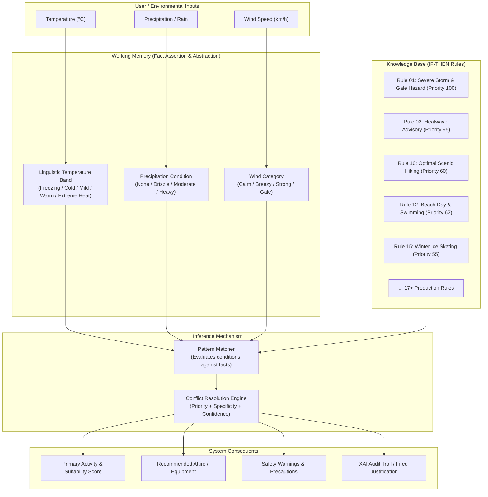

# ⛅ Weather Activity Advisor
> **A Rule-Based Expert System for Intelligent Activity Planning & Safety Guidance**  
> *Small AI Applications Mini Project Submission*

[](https://www.python.org/)
[](https://streamlit.io/)
[](#ai-system-architecture)
[](LICENSE)

---

## 📌 Project Overview

The **Weather Activity Advisor** is a small AI application built on an **Expert System architecture**. It ingests environmental observations—specifically **Temperature**, **Precipitation (Rain)**, and **Wind Speed**—and applies a forward-chaining inference mechanism over a curated **Knowledge Base (IF–THEN rules)** to recommend the most suitable indoor, outdoor, or water activity.

In addition to activity recommendations, the system provides:
- 🎒 **Attire & Gear Checklist** tailored to weather severity.
- ⚠️ **Health & Safety Advisories** (e.g., UV radiation, gale warnings, hypothermia, heatstroke precautions).
- 🔄 **Alternative Activities** if users desire backup choices.
- 🧠 **Explainable AI (XAI) Trace**: Full audit trail of working memory facts, matched candidate rules, conflict resolution decisions, and fired justifications.

---

## 🏛️ AI System Architecture



### 1. Knowledge Base (IF–THEN Rules)
The system stores declarative production rules in `knowledge_base.py`. Each rule defines:
- **Rule ID & Priority**: High-priority safety rules (e.g., gale warnings, thunderstorm alerts) carry priority `90–100` and preempt recreational outdoor rules.
- **Antecedents (IF)**: Qualitative and quantitative conditions on temperature, rainfall, and wind.
- **Consequents (THEN)**: Recommended activity, category (`Outdoor`, `Indoor`, `Water Sports`, `Safety Alert`, `Hybrid`), suitability percentage, apparel suggestions, safety warnings, and human-readable justification.

### 2. Inference Engine (Forward Chaining)
Implemented in `inference_engine.py`:
1. **Fact Assertion**: Continuous numeric values are discretized into linguistic bands (e.g., `< 5°C` $\rightarrow$ `Freezing`, `16–25°C` $\rightarrow$ `Mild / Pleasant`).
2. **Pattern Matching**: Evaluates every rule against the current Working Memory facts.
3. **Conflict Resolution Strategy**:
   - Primary: **Priority Value** (Severe safety alerts override leisure).
   - Secondary: **Condition Specificity** (Rules with more precise multi-variable matches outrank generic fallbacks).
   - Tertiary: **Suitability Score**.
4. **Explanation Generation**: Produces a live execution trace explaining *why* the winning rule was selected and why other candidate rules were resolved.

---

## 📂 Project Structure

```
AI/
├── app.py                 # Streamlit modern Web UI dashboard
├── app_gui.py             # Tkinter modern Desktop GUI (zero extra dependencies)
├── cli.py                 # Interactive terminal runner
├── knowledge_base.py      # AI Knowledge Base (IF-THEN rules & semantic discretization)
├── inference_engine.py    # Forward-chaining pattern matcher & conflict resolver
├── test_advisor.py        # Automated unit test suite (8 tests)
├── requirements.txt       # Project dependency specifications
├── .gitignore             # Git ignore file for Python/Streamlit
└── README.md              # Project documentation and submission guide
```

---

## 🚀 How to Run the Application

You can run the project using either the **Streamlit Web UI** (recommended for browser demonstration) or the **Tkinter Desktop UI** (runs out of the box with standard Python).

### 1. Prerequisites & Setup
Clone the repository (or navigate to the project directory):
```bash
git clone <YOUR_GITHUB_REPOSITORY_URL>
cd AI
```

*(Optional but recommended)* Create and activate a virtual environment:
```bash
python -m venv venv
# On Windows:
venv\Scripts\activate
# On macOS/Linux:
source venv/bin/activate
```

Install dependencies:
```bash
pip install -r requirements.txt
```

---

### Option A: Run Modern Streamlit Web UI (Recommended)
Launch the interactive web dashboard:
```bash
streamlit run app.py
```
*Or:*
```bash
python -m streamlit run app.py
```
Open your browser at **`http://localhost:8501`**.

**Features in Web UI:**
- 🎛️ Weather parameter sliders (Temperature, Rain type, Wind speed).
- ⚡ 8 One-click realistic weather presets (e.g., *Sunny Spring Hike*, *Severe Storm*, *Hot Beach Day*).
- 🎒 Interactive clothing and gear packing checklist.
- ⚠️ Visual safety advisory callouts.
- 🧠 Transparent **AI Inference Trace** displaying Working Memory facts, candidate rules, and full evaluation logs.
- 📚 Interactive **Knowledge Base Rule Explorer**.
- 💾 Export & Download Advisory Report as **JSON** or **TXT**.

---

### Option B: Run Tkinter Desktop UI (Zero Installation Required)
If you prefer running without Streamlit or an internet connection, use Python's built-in Tkinter:
```bash
python app_gui.py
```
This opens a desktop application featuring controls, output cards, and the rule trace log.

---

### Option C: Run Terminal CLI
For quick headless testing in the command prompt:
```bash
python cli.py
```

---

## 🧪 Running Automated Unit Tests

Run the test suite to verify rule firings, linguistic categorization, and conflict resolution:
```bash
python -m unittest test_advisor.py
```
Expected output:
```
........
----------------------------------------------------------------------
Ran 8 tests in 0.001s

OK
```

---

## 📋 Sample Scenarios & Rule Output

| Scenario | Inputs (Temp, Rain, Wind) | Winning Rule ID | Fired Recommendation | Category |
| :--- | :--- | :--- | :--- | :--- |
| **Pleasant Spring** | `22°C`, `None`, `10 km/h` | `R10_PERFECT_HIKING` | Scenic Mountain Hiking & Trail Trek | Outdoor |
| **Hot Summer** | `31°C`, `None`, `14 km/h` | `R12_SUMMER_BEACH_SWIM` | Beach Day, Swimming & Paddleboarding | Water Sports |
| **Severe Storm** | `18°C`, `Heavy Rain`, `58 km/h`| `R01_STORM_HAZARD` | Stay Safely Indoors & Avoid Travel | Safety Alert |
| **Heatwave** | `39°C`, `None`, `8 km/h` | `R02_EXTREME_HEAT` | Air-Conditioned Indoor Activities | Indoor |
| **Chilly Rain** | `11°C`, `Moderate Rain`, `18 km/h` | `R07_COLD_DRIZZLE_COFFEE`| Artisan Coffee Roastery & Cozy Reading Lounge | Indoor |
| **Coastal Wind** | `23°C`, `None`, `38 km/h` | `R08_STRONG_WIND_ADVENTURE` | Kite Buggying, Windsurfing, Power Kiting | Outdoor |
| **Freezing Winter**| `2°C`, `None`, `8 km/h` | `R15_WINTER_ICE_SKATE` | Outdoor Ice Skating Rink / Snowshoeing | Outdoor |

---

## 📤 GitHub Submission Guide

Follow these simple steps to upload this project to your GitHub account:

1. **Initialize Git in the project folder:**
   ```bash
   git init
   git add .
   git commit -m "Initial commit: Weather Activity Advisor Expert System"
   ```

2. **Create a new repository on GitHub:**
   - Go to [GitHub.com/new](https://github.com/new).
   - Enter Repository Name (e.g., `weather-activity-advisor`).
   - Leave it public and do **not** initialize with a README (one is already included).
   - Click **Create repository**.

3. **Link and push your local code:**
   ```bash
   git branch -M main
   git remote add origin https://github.com/<YOUR-USERNAME>/<YOUR-REPOSITORY-NAME>.git
   git push -u origin main
   ```

4. **Submit your link:**
   - Copy the GitHub URL (e.g., `https://github.com/<username>/weather-activity-advisor`) and submit it as requested.

---

## 📜 Academic Integrity & License
This project is prepared for the **Small AI Applications Mini Project**. Distributed under the [MIT License](LICENSE).
